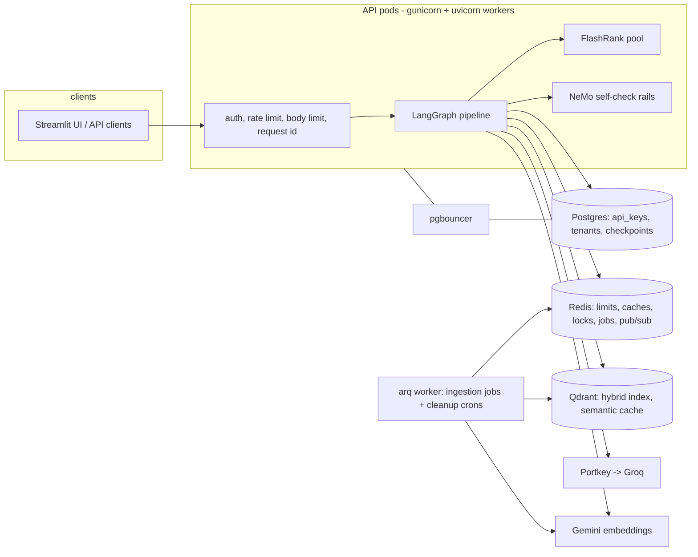

# Architecture

| concern | where |
|---|---|
| authentication, tenancy | `app/api.py`, `app/auth/` (hashed keys, scopes, per-tenant domain) |
| retrieval | `app/services/vectorstore.py` (named vectors, RRF, tenant filter), `sparse.py`, `reranker.py` |
| orchestration | `app/agents/graph.py` (cycle: retrieve -> grade -> rewrite) |
| safety | `app/guardrails/` (input/output rails, injection screen, deterministic output screen) |
| caches | planner cache, embedding cache, semantic answer cache (`app/services/`) |
| ingestion | `app/ingestion/` (idempotent, batched, blue/green with lock + dual-write + reconciliation) |
| ops | `/healthz`, `/readyz`, internal Prometheus port, Logfire with PII scrubbing, `deploy/k8s/base`, `docker-compose.yml` |

Details: `DOCS/01`..`DOCS/12`. Capacity numbers and their caveats: `DOCS/12_CAPACITY.md`.
