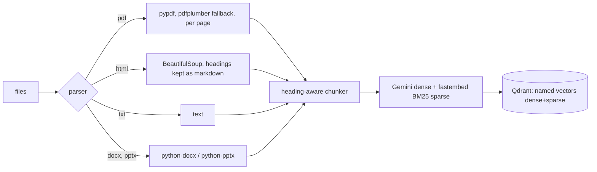

# Ingestion engine

`app/ingestion/pipeline.py::ingest()` is the single implementation, used by the CLI (`python -m app.ingestion.cli`) and the arq worker (`/ingest` endpoint -> `ingest_job`).



## Parsing
All local; no OCR service. Scanned/image-only PDFs yield no text and are reported as failed files. `#` lines inside code samples (docx/pptx/html) are escaped so they are not mistaken for headings.

## Chunking (`app/ingestion/chunking/splitter.py`)
Recursive: headings -> paragraphs -> lines -> sentences -> words. Sizes are *estimated tokens* (characters / 4, no tokenizer dependency):
`CHUNK_TARGET_TOKENS`=900, `CHUNK_OVERLAP_RATIO`=0.15 (overlap starts on a word boundary), `CHUNK_MIN_TOKENS`=200 (a new heading only starts a new chunk once the current one is at least this big).
Markdown-style headings build `heading_path`; the "1.2 Title" numbered-heading heuristic is used only for documents with no markdown headings (e.g. PDFs). Each chunk is embedded as `heading_path + text`.

## What is stored per point
Vectors `dense` (cosine, `EMBEDDING_DIM`=768 of `gemini-embedding-2`, normalised) and `sparse` (BM25, IDF applied by Qdrant). Payload: `tenant_id`, `source`, `source_type`, `page`, `heading_path`, `chunk_index`, `content_hash`, `file_hash`, `index_version`, `text`.
Payload indexes: `tenant_id` (keyword, `is_tenant=true`), `source_type`, `source`, `file_hash`. Collection metadata records `embedding_model`, `embedding_dim` and `schema` (`hybrid-v1`); startup refuses to run against an index that disagrees.

## Idempotency and updates
Point id = `uuid5(tenant, source, chunk_index, sha256(chunk))`. Re-ingesting unchanged files re-embeds nothing (existing ids are looked up first). When a file changed, points of the same `(tenant, source, source_type)` with a different `file_hash` are deleted after the upsert.
Upserts are batched (`INGEST_BATCH_SIZE`=128). Embeddings go through the Redis embedding cache. Per-file failures are collected; the CLI exits non-zero if any file failed. Aliases/collections: the alias `QDRANT_COLLECTION` points at `<alias>_v<N>`.

## Commands
```bash
python -m app.ingestion.cli DATA/true_data --tenant acme --source-type true     # incremental, idempotent
python -m app.ingestion.cli DATA/true_data --tenant acme --rebuild              # blue/green: new collection + atomic alias swap (exit 2 if another rebuild is running)
```
The legacy `--wipe` flag no longer exists.

## Rebuild coordination (close-out phase)
* **One rebuild per alias**: a Redis `SET NX EX` lock (`rebuild:<alias>:lock`) with a heartbeat; if Redis is unreachable a Postgres session advisory lock is used (mutual exclusion only). A second rebuild fails fast with `RebuildInProgress` (CLI exit code 2; `POST /ingest` with `rebuild=true` returns **409**).
* **Dual-write**: while a rebuild runs, its state `{live, candidate}` is in Redis and every `VectorStore.write_points` / `delete_where` aimed at the live collection is mirrored to the candidate, so writes for other tenants made during the rebuild survive the swap.
* **Reconciliation** just before the swap compares `content_hash` per point between live and candidate for every tenant except the rebuilt one, copies what is missing or different and deletes what only the candidate has.
* **Crash safety**: if the holder dies the heartbeat stops, lock and state expire after `REBUILD_LOCK_TTL_S`, mirroring stops, the live alias was never touched, and the next rebuild deletes orphaned `<alias>_vN` candidates (N above the live version). A handled exception deletes its own candidate.
* Limits: a rebuild of one tenant copies all other tenants' points (cost grows with the whole index); the rebuilt tenant's own writes during the rebuild are mirrored too but are superseded by the fresh ingest.
