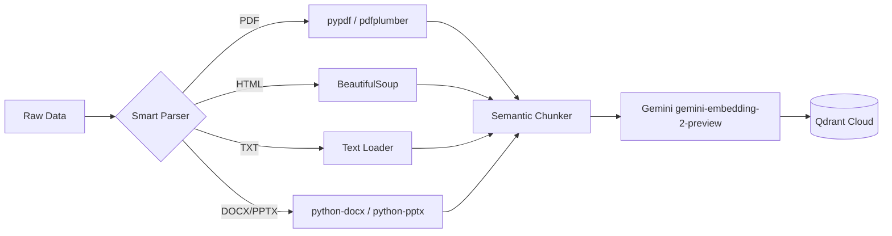

> **Current implementation:** `app/ingestion/pipeline.py::ingest()` (shared by the CLI and the arq worker).
> Point ids are `uuid5(tenant, source, chunk_index, content_hash)` so re-ingestion is idempotent and unchanged chunks are not re-embedded;
> changed files have stale points removed. Upserts are batched (`INGEST_BATCH_SIZE`). Every point carries `tenant_id`
> (keyword payload index, `is_tenant=true`), `source_type` and `source`. `--rebuild` builds `<alias>_v<N+1>`, copies other tenants'
> points, then atomically swaps the alias (aborting without a swap if any file failed). DOCX/PPTX use python-docx/python-pptx.
> The legacy `--wipe` flag is gone. Per-file failures are collected and the CLI exits non-zero.

# 📥 Ingestion Engine: Data to Knowledge

The Ingestion Engine is a modular, high-performance pipeline designed to convert raw enterprise data into a searchable vector format.

## 🔄 The Pipeline Flow


---

## 🛠️ Technical Specifications

### 1. Smart Parsing (Local, No External OCR)
All document parsing runs entirely on-device — no external OCR service or cloud API is required:
*   **PDFs**: Parsed locally via **pypdf** (primary) and **pdfplumber** (fallback for complex layouts). Handles multi-page PDFs without any page-count limits.
*   **HTML**: Processed via **BeautifulSoup**. It intelligently strips out `<script>`, `<style>`, and metadata tags to extract only the readable content.
*   **Office Docs**: Supports `.docx` via `python-docx` and `.pptx` via `python-pptx`.
*   **Plain Text**: Loaded directly with a simple text reader.

### 2. Semantic Chunking
*   **Chunk Size**: `1500` characters.
*   **Overlap**: Natural overlap (we split by paragraph breaks `\n\n` rather than arbitrary character counts).
*   **Logic**: The system uses a semantic-ish, paragraph-aware splitter. It attempts to keep paragraphs together to maintain context, ensuring that no chunk is cut off mid-sentence whenever possible. This prevents the LLM from getting "hallucinated" fragments.

### 3. Vectorization & Storage
*   **Embedding Model**: `gemini-embedding-2-preview` (Google Gemini). A state-of-the-art embedding model specifically tuned for retrieval tasks.
*   **Vector Dimensions**: `3072` dimensions.
*   **Vector Database**: **Qdrant**. We use a Cloud-hosted Qdrant instance for low-latency retrieval.
*   **Distance Metric**: **Cosine Similarity** (`models.Distance.COSINE`) is used to measure how closely a user query matches our document chunks.

---

## 🌍 Universal Ingestion Command
The engine is "Universal," meaning it automatically detects folder structures and maps them to metadata (e.g., "True" vs "Noisy" data).

```powershell
# Command to run the full ingestion
python -m app.ingestion.processor DATA --wipe
```


## Rebuild coordination (close-out phase)
* **One rebuild per alias**: a Redis `SET NX EX` lock (`rebuild:<alias>:lock`) with a heartbeat; if Redis is unreachable a Postgres session advisory lock is used (mutual exclusion only). A second rebuild fails fast with `RebuildInProgress` (CLI exit code 2; `POST /ingest` with `rebuild=true` returns **409**).
* **Dual-write**: while a rebuild runs, its state `{live, candidate}` is in Redis and every `VectorStore.write_points` / `delete_where` aimed at the live collection is mirrored to the candidate, so writes for other tenants made during the rebuild survive the swap.
* **Reconciliation** just before the swap compares `content_hash` per point between live and candidate for every tenant except the rebuilt one, copies what is missing or different and deletes what only the candidate has.
* **Crash safety**: if the holder dies the heartbeat stops, lock and state expire after `REBUILD_LOCK_TTL_S`, mirroring stops, the live alias was never touched, and the next rebuild deletes orphaned `<alias>_vN` candidates (N above the live version). A handled exception deletes its own candidate.
* Limits: a rebuild of one tenant copies all other tenants' points (cost grows with the whole index); the rebuilt tenant's own writes during the rebuild are mirrored too but are superseded by the fresh ingest.
