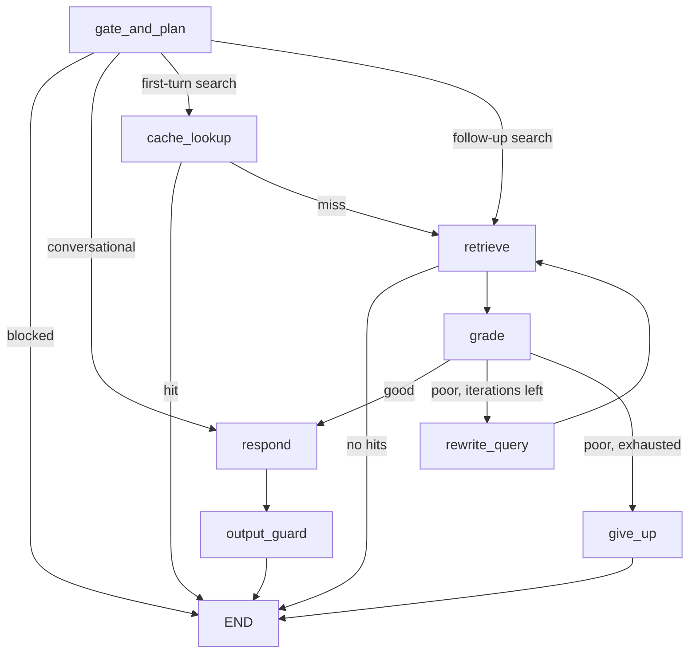

# The agent graph

A LangGraph state machine with **a real cycle**: `retrieve -> grade -> rewrite_query -> retrieve` (at most `MAX_RETRIEVAL_ITERATIONS`=2 retrievals per request).
Grading uses the top reranker score (no LLM call); only `rewrite_query` calls an LLM (the cheaper fallback model). All nodes are `async`. Tenant identity is taken from the
server-set `config["configurable"]["tenant_id"]`, never from state or the client.

`GET /graph` (admin key) returns the compiled graph as Mermaid text.

## Nodes
| node | what it does |
|---|---|
| `gate_and_plan` | Runs the input rail (NeMo `self check input`, with the tenant's domain on the first line of the checked text) **concurrently** with the planner (JSON: intent, refined query). A block discards the planner result. Planner answers are cached in Redis (tenant + normalised query + history + domain). |
| `cache_lookup` | Only for the first turn of a session. Embeds the *user's own words* and looks up the tenant's semantic cache (cosine >= `SEMCACHE_THRESHOLD`=0.95, same `index_version`, not expired). |
| `retrieve` | Embeds the query (dense) and encodes it (BM25 sparse), Qdrant prefetch (`PREFETCH_K`=40 per branch, tenant-filtered) -> RRF fusion (`FUSED_K`=10) -> FlashRank rerank (`FINAL_K`=5) -> injection screen. No hits at all => fixed "no relevant context" answer. Each pass is a Logfire span `retrieval iteration` with `iteration`. |
| `grade` | Good if the best kept chunk scores >= `RERANK_MIN_SCORE` (0.05). |
| `rewrite_query` | Asks the cheap model for a better keyword query, then loops back to `retrieve`. |
| `give_up` | Iterations exhausted: the fixed no-context answer (never from empty context). |
| `respond` | Builds the prompt with chunks wrapped in `<retrieved_context>` delimiters plus a system rule that they are data, not instructions. |
| `output_guard` | Deterministic secret/prompt-leak/exfil regexes, then NeMo `self check output`. Errors => 503. Stores to the semantic cache only grounded, unblocked first-turn answers. |

## State and memory
Conversation state lives in the Postgres LangGraph checkpointer under the thread id `tenant:user:session` (server-derived), written once per request (`durability="exit"`). One request per session at a time (Redis lock, otherwise 409).
Idle threads are deleted after `MEMORY_TTL_DAYS`. `MemorySaver` exists only for `APP_ENV=test`.
